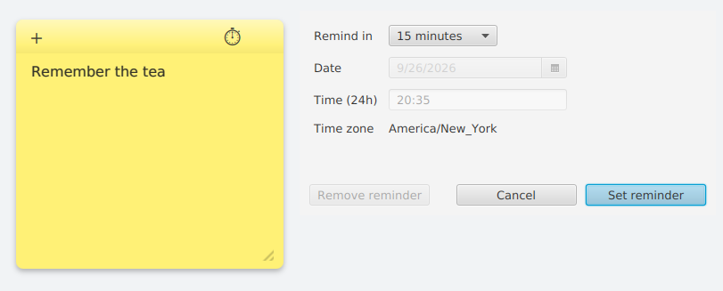

# Notesy

A Java 21 / JavaFX desktop sticky-note application with SQLite storage and optional
desktop reminders. Optional playful visuals use JavaFX transitions, with no Electron,
embedded browser, bundled JRE, or external animation engine.

## Development

Install a JDK 21+, Maven, GTK 3 and the desktop notification command. On Tumbleweed:

```sh
sudo zypper install java-21-openjdk-devel maven libgtk-3-0 libgthread-2_0-0 libnotify-tools
export JAVA_HOME=/usr/lib64/jvm/java-21-openjdk
mvn test
mvn javafx:run
```

The Maven development build downloads JavaFX and SQLite JDBC. The RPM instead
compiles offline against system OpenJFX and uses system SQLite JDBC at runtime.
The application jar does not embed any runtime or third-party libraries.
VS Code build, run, test, metadata and archive tasks are in `.vscode/tasks.json`.

## Notes And Reminders

- Drag the top strip; resize with the bottom-right grip.
- Use `+` for another note, the timer icon for a reminder, and the options menu
  for color swatches, keep-on-top, handwritten fonts, all notes, deletion and quit.
- Handwritten text is enabled when Chilanka, Patrick Hand, or Comic Sans MS is installed.
- Changes autosave after 400 ms; pending edits are flushed when a window closes or
  the app quits. Closing a note hides it; deletion requires confirmation.
- Reminders support 15 minutes, one hour, one day, one calendar month, one calendar
  year, or a future local date/time. Removing a reminder does not delete its note.
- Reminders require the app to be running. Overdue reminders fire on the next launch.
  The app does not wake a sleeping computer or install an autostart/background daemon.
- Failed notifications retain the reminder and retry after one minute. Successfully
  accepted notifications clear it. Desktop notification settings can still suppress display.
- Playful reminder visuals are opt-in; standard reminders remain the default.

## Playful Reminders (v1.2 Preview)

Open **Preferences...** from a note's options menu or the All Notes toolbar menu.
Enable **Enable playful reminder visuals**, then select **Egg**, **Bomb**, or
**Toaster**. Changes save immediately and apply to existing and future notes in
this application session. Disable the checkbox at any time to restore standard notes.

Artwork occupies a small, mouse-transparent footer area without covering note text.
Scheduled reminders show idle artwork, with a brief wobble near the deadline.
After the desktop notification service accepts delivery, the egg cracks to reveal
a note, the cartoon bomb becomes a small burst, or the toast pops up. The effect
then fades away. This is visual feedback only: scheduling, retries, notification
content, and SQLite note storage are unchanged. The existing reminder-setting
dialog is unchanged; no extra popup or sound is added when a reminder fires.

Hidden notes stop their animations and do not steal focus or open on delivery.
Changing modes or disabling visuals stops the previous effect immediately. Unknown
or unreadable preferences fall back to standard reminders; a failed save keeps the
previous selection and displays an error. Choosing a mode does not set a reminder.

Global preferences live in `$XDG_CONFIG_HOME/notesy/preferences.properties`, falling
back to `~/.config/notesy/preferences.properties`. Missing fields default to
`playfulModeEnabled=false` and `playfulModeType=NONE`. No database migration is needed.

| Standard reminder | Egg | Bomb | Toaster |
| --- | --- | --- | --- |
|  |  |  |  |

These are snapshots of the JavaFX UI, generated by the opt-in UI test. The standard
image combines the note and reminder dialog snapshots side by side. The vector
artwork is defined directly in `ui.playful`; no third-party artwork is included.

Data is stored in `$XDG_DATA_HOME/sticky-notefx/notes.db`, falling back to
`~/.local/share/sticky-notefx/notes.db`. Notes are not encrypted. Back up the data
directory while the app is closed. A file lock prevents two instances sharing it.
For an isolated development profile, use
`mvn -Djavafx.options=-Dstickynotefx.dataDir=/tmp/sticky-test javafx:run`.

## Validation

```sh
mvn verify
STICKYNOTEFX_UI_TEST=1 xvfb-run -a mvn test
make check-metadata
make source-dist
```

UI tests are opt-in because they require a real or virtual X display. JavaFX 21
on Wayland currently uses XWayland; final placement and always-on-top behavior
depend on the compositor. Test KDE and GNOME before release.

The opt-in test also needs `notify-send` and a desktop notification service for its
end-to-end delivery check; it sends one test notification. It verifies all visual
modes, preference controls, cross-window updates, animation cleanup, non-clipping,
focus preservation, and unchanged note content. PNGs are written to
`target/ui-snapshots`. On an active desktop, omit `xvfb-run`.

## Packaging Status

`make source-dist` creates `dist/Notesy/` with the source tarball, spec,
desktop entry, AppStream metadata, and changelog for an OBS package checkout.
The spec is a draft, **not a Factory-approved release**. A license has not been
chosen, so its `LicenseRef-UNLICENSED` marker must be replaced with the approved
SPDX identifier and an accompanying license file before distribution. A real
developer identity, published screenshot URLs, OBS build and Factory review are
also release gates. No OBS upload or Factory submission is automated.

The installed Tumbleweed OpenJFX 17.0.20.0-2.1 native libraries also failed local
startup with unresolved X11/C++ symbols. This must be resolved and the installed
RPM tested before release. The Maven JavaFX 21 UI tests pass. This branch contains
the v1.2 visual implementation, not an approved v1.2 release; package versions remain
unchanged until the platform, performance, licensing and distribution gates pass.

See [architecture](docs/ARCHITECTURE.md), [maintainer steps](docs/MAINTAINERS.md),
and the [versioned engineering task list](docs/TASKS.md).