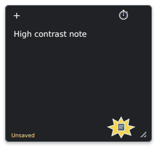
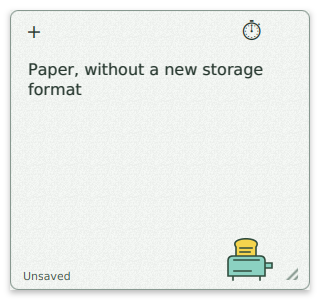
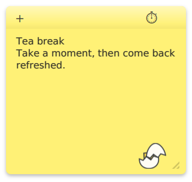
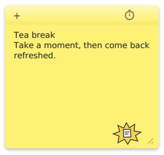

# Notesy

A Java 21 / JavaFX desktop sticky-note application with SQLite storage and optional
desktop reminders. Optional playful visuals use JavaFX transitions, with no Electron,
embedded browser, bundled JRE, or external animation engine.

## Development

Install a JDK 21+, Maven, GTK 3 and the desktop notification command. On Tumbleweed:

```sh
sudo zypper install java-21-openjdk-devel maven libgtk-3-0 libgthread-2_0-0 libnotify-tools
export JAVA_HOME=/usr/lib64/jvm/java-21-openjdk
mvn test
mvn javafx:run
```

The Maven development build downloads JavaFX and SQLite JDBC. The RPM instead
compiles offline against system OpenJFX and uses system SQLite JDBC at runtime.
The application jar does not embed any runtime or third-party libraries.
VS Code build, run, test, metadata and archive tasks are in `.vscode/tasks.json`.

## Notes And Reminders

- Drag the top strip; resize with the bottom-right grip.
- Use `+` for another note, the timer icon for a reminder, and the visible pin to
  keep a note on top. The options menu contains color swatches, handwritten fonts,
  reminder visuals, all notes, deletion and quit.
- The list icon (**Browse notes**) opens the existing non-modal notes browser
  without closing the current note. **Show all sticky notes**, in the browser's
  options menu, explicitly shows the individual sticky windows instead.
- The horizontal line beside X saves and minimizes only the current note.
  X saves and hides only that note; it never opens or focuses the browser.
  Save failures leave the note visible. Closing the last visible window does
  not quit Notesy: use the application-menu entry again to reach saved notes.
  Use **Quit Notesy** / **Quit** to save and exit explicitly.
- The Expand icon is a disabled development placeholder with an explanatory
  tooltip; integrated Browser and Notebook modes are not implemented yet.
  See the [UI evolution proposal](docs/UI-EVOLUTION.md) for the phased design.
- Handwritten text is enabled when Chilanka, Patrick Hand, or Comic Sans MS is installed.
- Changes autosave after 400 ms; pending edits are flushed when a window closes or
  the app quits. Closing a note hides it; deletion requires confirmation.
- Reminders support 5, 10, 15 and 30 minutes, one or two hours, one day, one calendar month, one calendar
  year, or a future local date/time. Removing a reminder does not delete its note.
- Reminders require the app to be running. Overdue reminders fire on the next launch.
  The app does not wake a sleeping computer or install an autostart/background daemon.
- Failed notifications retain the reminder and retry after one minute. Successfully
  accepted notifications clear it. Desktop notification settings can still suppress display.
- Playful reminder visuals are opt-in; standard reminders remain the default.

## Playful Reminders (v1.2 Preview)

Choose **Reminder visual > Egg / Bomb / Toaster** in a note's options menu to opt
in for that note. Different notes can use different graphics. Choose **None** to
disable the overlay without changing note content or its reminder.

**Preferences...** controls the default selection for new notes and notes without
a saved override. Changing defaults does not overwrite an explicit per-note choice.

Artwork occupies a small, mouse-transparent footer area without covering note text.
Scheduled reminders show idle artwork, with a brief wobble near the deadline.
After the desktop notification service accepts delivery, the egg cracks to reveal
a note, the cartoon bomb becomes a small burst, or the toast pops up. The expired
artwork remains static until **Clear reminder / visual** or a new reminder/snooze.
It survives hide/show and normal app restart without replaying the animation.
Scheduling, retries, notification text and SQLite note storage are unchanged;
no extra popup or sound is added on delivery.

Hidden notes stop their animations and do not steal focus or open on delivery.
Changing modes or disabling visuals stops the previous effect immediately. Unknown
or unreadable preferences fall back to standard reminders; a failed save keeps the
previous selection and displays an error. Choosing a mode does not set a reminder.

Legacy global defaults live in `$XDG_CONFIG_HOME/notesy/preferences.properties`, falling
back to `~/.config/notesy/preferences.properties`. Missing fields default to
`playfulModeEnabled=false` and `playfulModeType=NONE`. No database migration is needed.
New per-profile theme and per-note visual choices live in `visuals.properties`
beside that profile's `notes.db`. Only `theme` and each note's `playfulModeEnabled`,
`playfulModeType`, and `playfulExpiredState` are stored there. Neither the existing
database schema nor the legacy preferences format changes. Back up both files.

## Themes And Window Controls

**Preferences > Theme** offers Light (default), high-contrast Dark, and textured
Paper. CSS applies to notes, controls, borders, menus and dialogs; underlying note
colours remain unchanged. Open and new note windows share the profile's theme.
Theme changes save preferences immediately and queue the existing 400 ms note
autosave; close/quit still flush pending edits. Native move and resize events also
queue autosave using the existing note coordinates.

Enable **Avoid overlap for new notes (this session)** in Preferences to choose
free screen space; when the screen is full this minimizes overlap. It is off by
default and does not reposition existing notes. Show All preserves the previously
focused note on top. **Snap to
grid (this session)** is per-window, optional, off by default, and snaps to a 20-pixel
grid on drag release. It is not persisted and does not change ordinary free movement.

**Snooze > 5 / 10 / 30 minutes** reschedules the selected note using the existing
reminder setter. Reminder tooltips include zone/offset information. The dialog's
**Preview zone** converts the displayed time only: custom dates and times are still
entered in the system zone, and scheduling is unchanged. The optional desktop
action **Open Notesy** (`notesy --all-notes`) opens the existing All Notes window
after normal startup; it does not add a second lifecycle or bypass the profile lock.

| High-contrast Dark | Textured Paper |
| --- | --- |
|  |  |

| Standard reminder | Egg | Bomb | Toaster |
| --- | --- | --- | --- |
|  |  |  |  |

These are snapshots of the JavaFX UI, generated by the opt-in UI test. The standard
image combines the note and reminder dialog snapshots side by side. The vector
artwork is defined directly in `ui.playful`; no third-party artwork is included.

Data is stored in `$XDG_DATA_HOME/sticky-notefx/notes.db`, falling back to
`~/.local/share/sticky-notefx/notes.db`. Notes are not encrypted. Back up the data
directory while the app is closed. A file lock prevents two instances sharing it.
For an isolated development profile, use
`mvn -Djavafx.options=-Dstickynotefx.dataDir=/tmp/sticky-test javafx:run`.

## Validation

```sh
mvn verify
STICKYNOTEFX_UI_TEST=1 xvfb-run -a mvn test
make check-metadata
make source-dist
```

UI tests are opt-in because they require a real or virtual X display. JavaFX 21
on Wayland currently uses XWayland; final placement and always-on-top behavior
depend on the compositor. Test KDE and GNOME before release.

The opt-in test also needs `notify-send` and a desktop notification service for its
end-to-end delivery check; it sends one test notification. It verifies all visual
modes, preference controls, cross-window updates, animation cleanup, non-clipping,
focus preservation, and unchanged note content. PNGs are written to
`target/ui-snapshots`. On an active desktop, omit `xvfb-run`.
There are 18 native UI test cases, separate from the repository, scheduler and
preferences unit tests. Run all of them with
`STICKYNOTEFX_UI_TEST=1 mvn clean verify` on an active desktop.

The paper tile and 32/64/128/256-pixel icons are generated with
`java scripts/GenerateVisualAssets.java`; no new dependency is needed. Icons match
the original desktop SVG geometry. Runtime icon selection supports HiDPI screens;
the scalable desktop SVG is retained. Multi-monitor DPI transitions still require
hands-on compositor testing.

## Packaging Status

`make source-dist` creates `dist/Notesy/` with the source tarball, spec,
desktop entry, AppStream metadata, and changelog for an OBS package checkout.
The project and its original artwork are licensed under **GPL-3.0-or-later**;
see [LICENSE](LICENSE) and [asset provenance](docs/ARTWORK.md). AppStream metadata
is separately licensed under CC0-1.0 as declared in the metadata file.
The spec is a draft, **not a Factory-approved release**. A confirmed
developer identity, published release source, OBS build and Factory review are
also release gates. No OBS upload or Factory submission is automated.

The installed Tumbleweed OpenJFX 17.0.20.0-2.1 native libraries also failed local
startup with unresolved X11/C++ symbols. This must be resolved and the installed
RPM tested before release. The Maven JavaFX 21 UI tests pass. This branch contains
the v1.2 visual implementation, not an approved v1.2 release; package versions remain
at the approved version 1.0 until the platform, performance and distribution gates pass.

See [architecture](docs/ARCHITECTURE.md), [maintainer steps](docs/MAINTAINERS.md),
the [versioned engineering task list](docs/TASKS.md), and the current
[Factory readiness report](docs/READINESS.md).